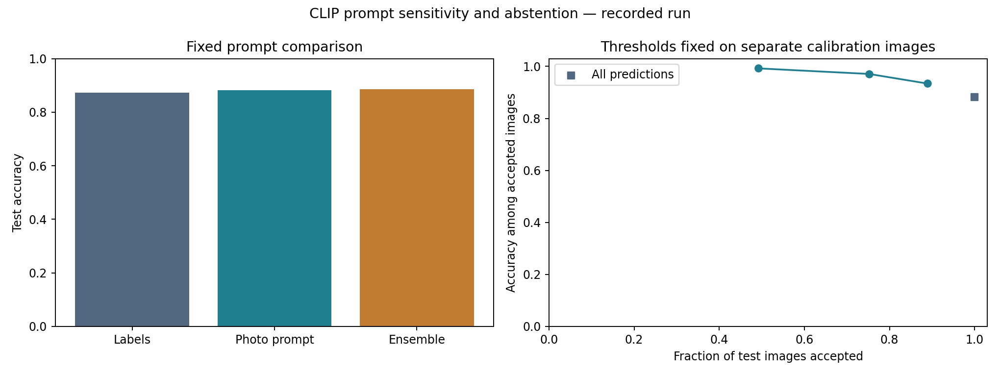

# Multimodal Classification: Accuracy, Prompt Sensitivity, and Abstention

Joe Williams · Portfolio project 4

**Completed evaluation: 10,000 CIFAR-10 test images, three fixed prompt methods, and three review thresholds.** The development-selected photo prompt reached **88.23% overall accuracy**. At the primary threshold it accepted **75.18% of images with 97.10% accuracy among accepted predictions**, leaving **218 accepted errors** and **2,482 images for review**.

[Executed notebook](Multimodal_Classification_Evaluation.ipynb) · [Full results review](analysis/results_review.md) · [Code walkthrough](CODE_WALKTHROUGH.md) · [Saved evidence](results/multimodal_20261124T171506Z-2512b9)

## Results

| Prompt method | Development accuracy | Test accuracy | Test macro F1 |
|---|---:|---:|---:|
| Class labels only | 88.5% | 87.35% | 0.8734 |
| **Photo prompt — selected on development** | **89.1%** | **88.23%** | **0.8817** |
| Five-template ensemble | 89.0% | 88.54% | 0.8847 |

The ensemble scored highest on the test set, but the review policy keeps the method selected on development data. Photo prompts gained 0.88 percentage points over bare labels (paired bootstrap 95% interval: +0.49 to +1.31). The ensemble gained 0.31 points over the photo prompt (+0.05 to +0.59). These are descriptive intervals for this benchmark, not evidence of the same gain on a new image domain.

| Calibration coverage target | Test coverage | Accepted accuracy | Accepted errors | Review queue |
|---|---:|---:|---:|---:|
| 50% | 49.12% | 99.25% | 37 | 5,088 |
| **75% — primary** | **75.18%** | **97.10%** | **218** | **2,482** |
| 90% | 88.88% | 93.41% | 586 | 1,112 |

At the primary cutoff, 7,300 predictions were correctly accepted and 218 were incorrectly accepted. The review queue contained 959 errors and 1,523 correct predictions. Routing an error for review does not demonstrate that a reviewer corrected it. **97.10% applies to the accepted subset, not all 10,000 images.**

Results differed by category: 56.5% of frog images were referred versus 8.2% of horse images. Accepted deer predictions were 89.89% accurate. The overall result alone therefore does not describe every category's error rate or review burden.



The right-hand chart shows only the selected photo prompt at the three fixed thresholds; the connecting line is not a fully sampled risk–coverage curve.


This project asks whether text prompt choices affect a frozen vision-language classifier, and whether a fixed score threshold can reduce errors among accepted predictions at an acceptable review workload. It extends the image/text embedding concepts in Chapter 9 of *Hands-On Large Language Models* into a reproducible evaluation.

## Experiment

| Configuration | Description |
|---|---|
| Label only | Compare each image with the ten class names. |
| Photo prompt | Compare with descriptions such as “a photo of an airplane.” |
| Prompt ensemble | Average five fixed, normalized text embeddings for each class, then normalize the average. |

All methods use the same frozen `openai/clip-vit-base-patch32` checkpoint, image preprocessing, and image vectors. The class order is airplane, automobile, bird, cat, deer, dog, frog, horse, ship, truck. There is no task-specific weight training. Prompt selection still uses labeled development data, so “zero-shot” does not mean there is no supervised configuration selection.

The dataset and model use immutable revisions in `config.json`. The dataset loader also verifies the Parquet file hashes and class-order metadata. The original CIFAR-10 split has 50,000 training and 10,000 test images. Decoded RGB hashes are used to exclude exact train/test copies from development eligibility and remove repeated training images before sampling. All official test rows are retained.

- **Prompt selection:** 100 images per class from eligible training rows (1,000 total). Select highest top-1 accuracy; ties favor label only, then the photo prompt, then the ensemble.
- **Threshold setting:** a disjoint 100 images per class (1,000 total). For the selected method, fix cutoffs targeting 50%, 75%, and 90% empirical coverage. The primary target is 75%.
- **Final evaluation:** all 10,000 official test images. Evaluate every unchanged prompt method and apply the locked cutoffs to the selected method.

The cutoff is the `ceil(target × N)`-th largest score; accept scores at least as large. Ties may raise calibration coverage above its target. Test coverage is measured, not guaranteed. The calibration sample sets thresholds; it does not calibrate probability estimates.

## What is measured

For each prompt configuration: accuracy, macro F1, per-class recall, confusion counts, every image's logits/prediction/score, and paired bootstrap intervals for accuracy differences. The bootstrap uses 2,000 ordinary paired-image resamples with a fixed seed, implemented through equivalent multinomial sampling of correctness differences.

For the selected configuration: accepted and referred counts, achieved test coverage, accuracy among accepted images, remaining accepted errors, errors routed for review, and per-class coverage/accepted accuracy. The denominator for selective accuracy is the accepted set. Referred errors have not been shown to be corrected by human reviewers. Correct predictions sent for review also consume time.

Model loading, text encoding, image encoding, and score computation times are recorded separately. These are batched experiment timings, not production request latency or independent runtime comparisons between methods: every method reuses the same image embeddings.

## Run in Colab

1. Upload `Multimodal_Classification_Evaluation.ipynb` to Google Colab.
2. Choose **Runtime → Change runtime type → T4 GPU**, using a fresh runtime.
3. Choose **Run all**. No API key is required. GPU availability and runtime duration depend on Colab.
4. The last cell downloads `multimodal_<timestamp>-<id>.zip`. Also use **File → Download → Download .ipynb** to save the executed notebook.
5. Keep both files to compare a new run with the recorded run. The notebook in this repository already contains the completed outputs and interpretation.

The notebook contains all helper code and does not need the companion files. It installs pinned libraries while retaining Colab's GPU PyTorch. The official checkpoint requires PyTorch 2.6 or newer when loaded through this configuration. CPU is supported for the small CLI preparation check, but the full notebook intentionally asks for a GPU.

For a local GPU environment with an appropriate PyTorch build:

```bash
pip install -r requirements.txt
python run_experiment.py
```

A small integration check uses **60 official training images only**:

```bash
python run_experiment.py --smoke
```

## Verify saved evidence

To check the included run without model inference, run from this repository root:

```bash
pip install numpy
python scripts/verify_results.py results/multimodal_20261124T171506Z-2512b9
```

The verifier checks file hashes, shapes, labels, sample separation, saved pixel hashes, prompt strings, normalized text prototypes, method selection, threshold calculation, aggregate/per-image metrics, paired bootstrap records, and CSV tables. This establishes internal consistency. It does not repeat neural inference, validate the benchmark's annotations, or prove execution chronology.

Run the metric and sampling tests:

```bash
python -m unittest discover -s tests -v
```

The completed run passed hash and metric checks, all 36,000 prediction rows matched saved logits, and all 12,000 evaluated image IDs/labels/pixel hashes matched the pinned source data. An independent scikit-learn audit matched all nine split-by-method metric sets. See [verification details](analysis/verification.json). The `validation/` directory records earlier preparation checks separately; those small checks are not benchmark performance.

## Business interpretation

The transferable pattern is evaluating image-tagging suggestions and routing uncertain cases for review. On this benchmark, the primary policy would create 2,482 reviews per 10,000 images while allowing 218 errors through automatically. A pilot could compare three choices: review everything, accept everything, or use a fixed routing policy. Measure reviewer time, reviewer mistakes, missed errors, and cost per completed item for each choice. A business pilot would need its own permitted images, taxonomy, representative error labels, review process, and cost measurements. It would compare time saved against remaining errors and review workload. This benchmark does not establish performance for product catalogs, maritime imagery, safety tasks, or deployed systems.

## Limits

CIFAR-10 images are only 32×32 pixels, with a closed set of ten classes. Resizing cannot recover missing detail. CLIP's pretraining overlap is unknown; zero-shot inference does not prove these images were unseen during pretraining. The exact-pixel audit does not detect near duplicates or semantic overlap. Maximum softmax changes with the candidate classes and logit scale and is not calibrated correctness or reliable unfamiliar-image detection. A higher accuracy on retained predictions must always be shown alongside coverage and remaining errors.

Bootstrap intervals are conditional descriptive intervals, assume exchangeable image rows, and do not account for domain shift, annotation uncertainty, correlations between similar images, or the three-comparison multiplicity. No claim of independent annotation reliability or downstream financial benefit is made.

See `CODE_WALKTHROUGH.md` for explanations and `ATTRIBUTION.md` for sources. Dataset images and model weights are downloaded separately; they are not bundled or relicensed by this project's code license.
